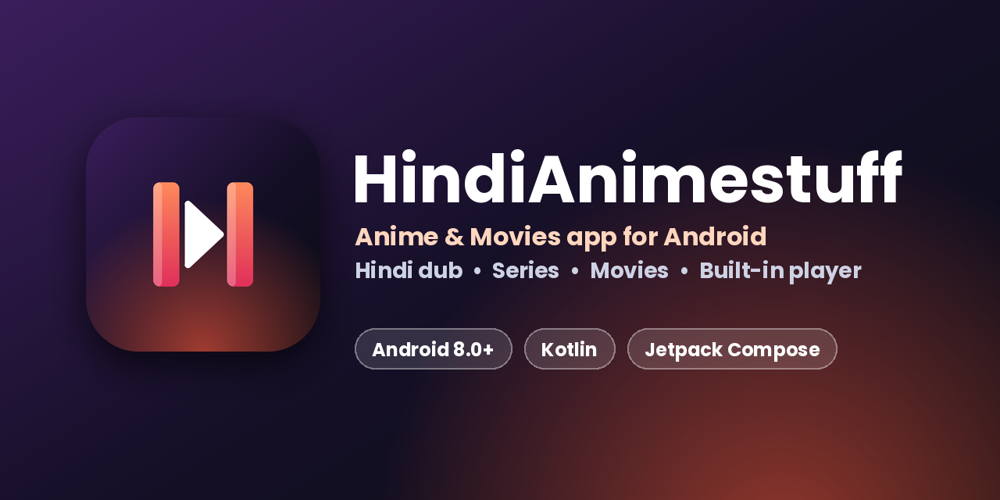

# HindiAnimestuff for Android

**Hindi dub anime, series & movies app — fast, clean, ad-light.**
*हिंदी डब एनीमे, सीरीज़ और मूवीज़ के लिए Android ऐप*

[**⬇ Download APK**](https://github.com/Youtuberec2arc/HindiAnimestuff-Apk/releases/latest) ·
[**🌐 Website**](https://hindianimestuff.web.app) ·
[**💬 Telegram**](https://t.me/HindiAnimestuff)

---

## ✨ What is HindiAnimestuff?

HindiAnimestuff is a native **Android anime app** built for people who like **Hindi dubbed anime**, plus popular **series and movies**. Browse a big catalogue with posters, ratings, genres and episode lists, then watch in the built-in player or grab the file with one tap.

The catalogue refreshes by itself from the website, so **new anime and episodes show up without reinstalling the app.**

## 🎬 Features

| | |
|---|---|
| 🏠 **OTT-style home** | Big hero banner that auto-slides, then rows for *Latest Anime*, *Anime Movies*, *Movies* and *Series* |
| 🔎 **Fast search** | Type a title and get results instantly, across anime, movies and series |
| 🔥 **Trending & genres** | Find what's popular, filter any category by genre |
| ▶️ **Built-in player** | Play / pause, stop, ±10 s seek, next episode, mute, fullscreen, quality switch (480p / 720p / 1080p) and audio-track picker |
| ⬇️ **Smart downloads** | Direct files download straight to your phone; other links open inside the app until the download starts |
| ❤️ **Favourites** | Save titles and come back to them later |
| 💬 **Comments** | Read and post comments on every title |
| 🔄 **Auto-updating catalogue** | New titles appear on their own — no new APK needed |
| 🆙 **In-app update** | *Menu → Update App* fetches the latest version |
| 🌙 **Dark, clean UI** | Material 3 design made for phones |

## 📲 Install

1. Open the [**latest release**](https://github.com/Youtuberec2arc/HindiAnimestuff-Apk/releases/latest) and download the `.apk` file.
2. Tap the downloaded file. If Android asks, allow **Install unknown apps** for your browser / file manager.
3. Open **HindiAnimestuff** and enjoy.

> **Requirements:** Android 8.0 (API 26) or newer · internet connection

**Updating:** open the app → **Menu → Update App**, or just download the newest APK from [Releases](https://github.com/Youtuberec2arc/HindiAnimestuff-Apk/releases) and install it over the old one — your favourites stay.

## ❓ FAQ

<b>Do I need to reinstall the app to see new anime?</b>

No. The catalogue is downloaded from the website every time you open the app (and when you come back to it), so new titles and episodes appear automatically. You can also tap <b>Menu → Refresh list</b>.

<b>A video won't play, what should I do?</b>

Switch the quality (720p / 480p usually play on every phone). If it still fails, use the <b>Download</b> button and open the file in VLC or MX Player.

<b>A link opens a web page instead of downloading</b>

Some hosts show a page first. It opens inside the app — just tap its download button and the download starts. If a page misbehaves, tap <b>Browser</b> in the top bar to open it in Chrome.

<b>Is it safe to install?</b>

The APK is published only on this page and is built from the project's own source. Always download from the <a href="https://github.com/Youtuberec2arc/HindiAnimestuff-Apk/releases">Releases</a> section above, not from random mirror sites.

## 🧰 Built with

**Kotlin** · **Jetpack Compose** (Material 3) · **Media3 / ExoPlayer** · **Coil** · **Navigation Compose** · Firebase Hosting for the catalogue

## 🔗 Links

| | |
|---|---|
| 🌐 Website | <https://hindianimestuff.web.app> |
| 💬 Telegram channel | <https://t.me/HindiAnimestuff> |
| ⬇ Latest APK | <https://github.com/Youtuberec2arc/HindiAnimestuff-Apk/releases/latest> |

## ⚖️ Disclaimer & copyright

HindiAnimestuff **does not host, upload or store any video files.** The app only lists links that point to content hosted by independent third parties. All anime, movies, posters and trademarks belong to their respective owners.

If you are a copyright owner and want a link removed, please use the [DMCA page](https://hindianimestuff.web.app/dmca.html) or message us on [Telegram](https://t.me/HindiAnimestuff) and it will be taken down promptly.

---

**If you like the app, give this repo a ⭐ — it helps other anime fans find it.**

Made with ❤️ for anime fans.

